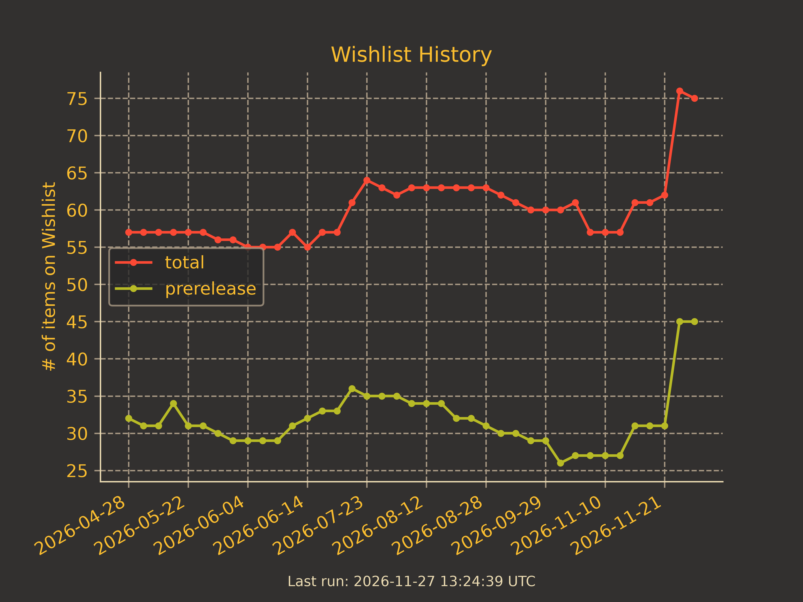
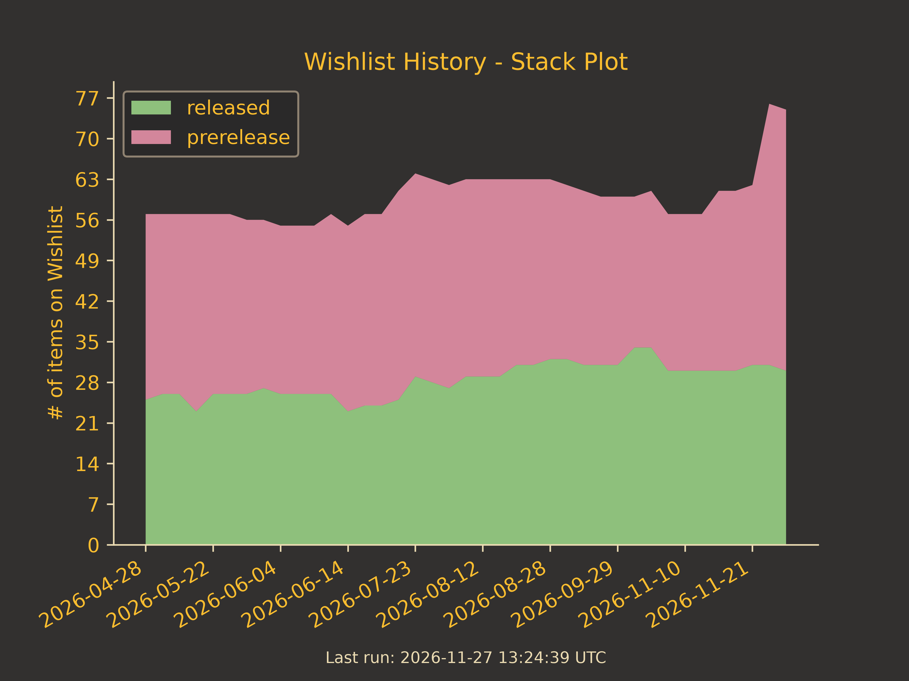

# Steam Wishlist Calendar

> [!NOTE]
> This is a personal fork of [icue/SteamWishlistCalendar](https://github.com/icue/SteamWishlistCalendar). Its only purpose is to run the GitHub Action for my own Steam wishlist. It is not developed as a separate project. Issues and pull requests belong in the [original repository](https://github.com/icue/SteamWishlistCalendar), and so does anyone who wants a calendar for their own wishlist.
>
> The calendar generated here is published at `https://raw.githubusercontent.com/NeoVG/SteamWishlistCalendar/main/output/wishlist.ics`.

Automatically tracks Steam wishlist release dates and publishes `.ICS` file that can be subscribed.

My wishlist history:

 

---
**Instructions from the original project** ([简体中文/Simplified Chinese version](https://github.com/icue/SteamWishlistCalendar/wiki/%E4%BD%BF%E7%94%A8%E8%AF%B4%E6%98%8E))
1. Make sure your Steam profile is public.
2. `pip install -r requirements.txt`
3. `python swc.py -i={steam ID}` or `python -m swc -i={steam ID}`, where steam ID is the long number you see in your profile URL. If you have a custom URL, you can find out your steam ID here: https://steamid.io/
    
   Optional parameters:
   * `-d`: whether to include DLCs. Default is `False`.
4. When finished, the script generates 5 files in [`/output`](output/) directory.
    * [`wishlist.ics`](output/wishlist.ics): an `.ICS` file, which can be imported into common calendar applications, such as Google Calendar and Outlook. Learn more about this format on [Wikipedia](https://en.wikipedia.org/wiki/ICalendar).
    * [`history.json`](output/history.json): stores the number of wishlisted items, as well as the number of pre-releases among them, of the day. Keeps growing.
    * [`successful.txt`](output/successful.txt): stores the items that either has an explicit release date or has a vague release date successfully converted into an exact date. Each line contains first the item name, then the release date.
    * [`wishlist_history_chart.png`](https://github.com/NeoVG/SteamWishlistCalendar/blob/output/output/wishlist_history_chart.png): a line chart that shows the trend of the wishlist. What gets displayed here also depends on data in [`history.json`](output/history.json).
    * [`wishlist_history_stack_plot.png`](https://github.com/NeoVG/SteamWishlistCalendar/blob/output/output/wishlist_history_stack_plot.png): a stack plot that shows the trend of the wishlist. What gets displayed here also depends on data in [`history.json`](output/history.json).
5. Refer to the [workflow yml file](.github/workflows/analyze-wishlist.yml) in this repo, to automatically run the script on schedule. Note that the workflow will use a branch named "output" particularly to store the output image, where the history will not be tracked. This is to prevent the repo size from expanding rapidly.
6. If you choose to publish the `.ICS` file, such as on GitHub, you may then have your calendar app subscribe to that file. Effectively what you get is a calendar that syncs with the release dates of the items on your wishlist.
